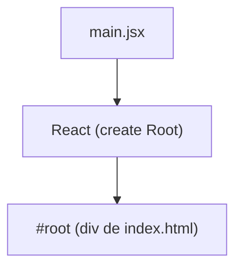

# Clase 08: DOM y tests

## REsumen flujo React

> Document object model. La representación en memoria de la página web.

### 1. index.html

Comienza con el `index.html`, la única página html del proyecto. Es el documento
HTML base que contiene el contenedor principal `

`. Carga el
punto de entrada React.

### 2. main.jsx

Es el punto de entrada de REact. Importa `createRoot` y `App`. Conecta React con
#root.

### 3. App.jsx

Es el componente raíz de la aplicación. Organiza la interfaz general. Puede
contener `Navbar`, `Footer`, `State` y `Routes`.

### 4. Pages y Components

Los pages son vistas completas y los componentes son piezas reutilizables que se
usan dentro de las páginas o en App.

### 5. React renderiza

Reac evalúe el JSX. Contruye una representación de la interfaz en memoria.
Cuando cambia el State o las Pops, React vuelve a renderizar el componente.

### 6. DOM en el navegador

El navegador muestra elementos HTML reales. React actualiza solo lo que cambió.

---

## Pruebas unitarias

Como funciona una prueba unitaria en React con Vitest

### 1. Arrange (preparar)

- Importar herramients: describe, test, expect, vi, render, screen, userEvent.
- Crear mocks: sintetizamos lo que no queremos probar.
- Renderizar el componente: render(`<LoginForm onLogin={onLogin} />`)
- Estado inicial esperado: Inputs vacíos o valores iniciales listos para la
  prueba.

### 2. Act

- Buscar elementos
- Simular acciones

### 3. Assert
